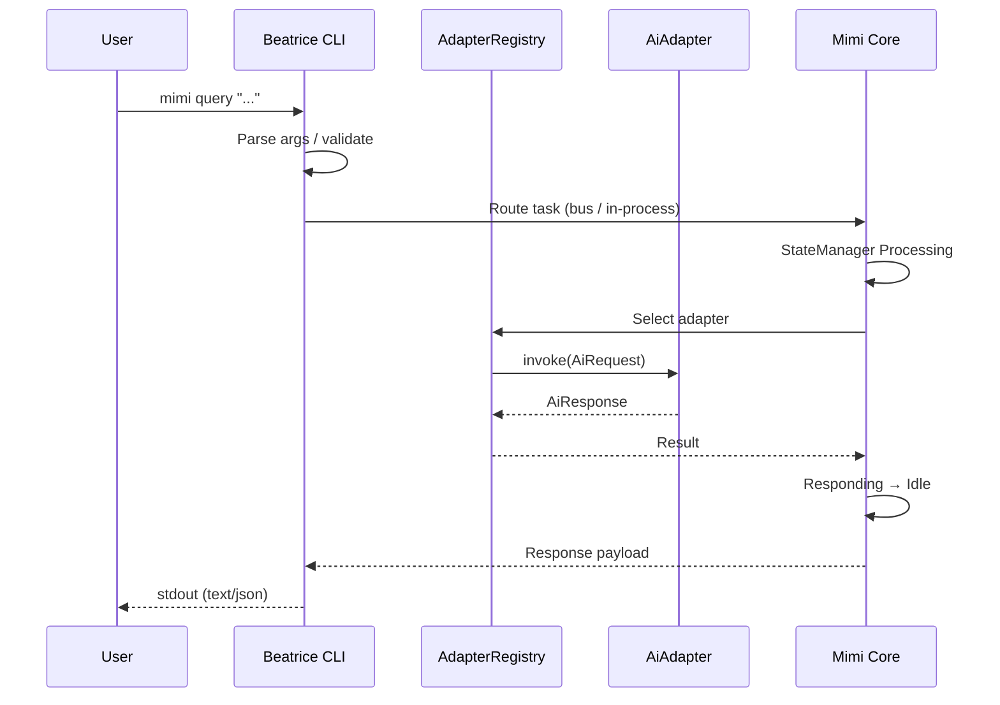
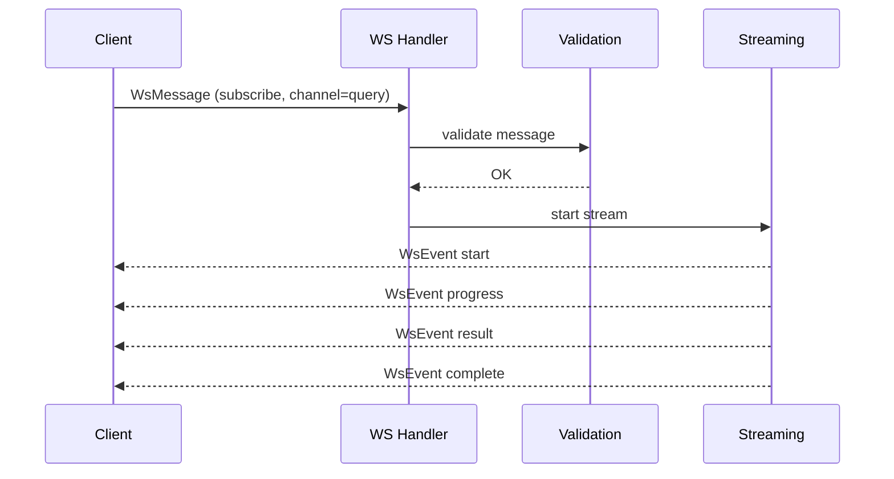
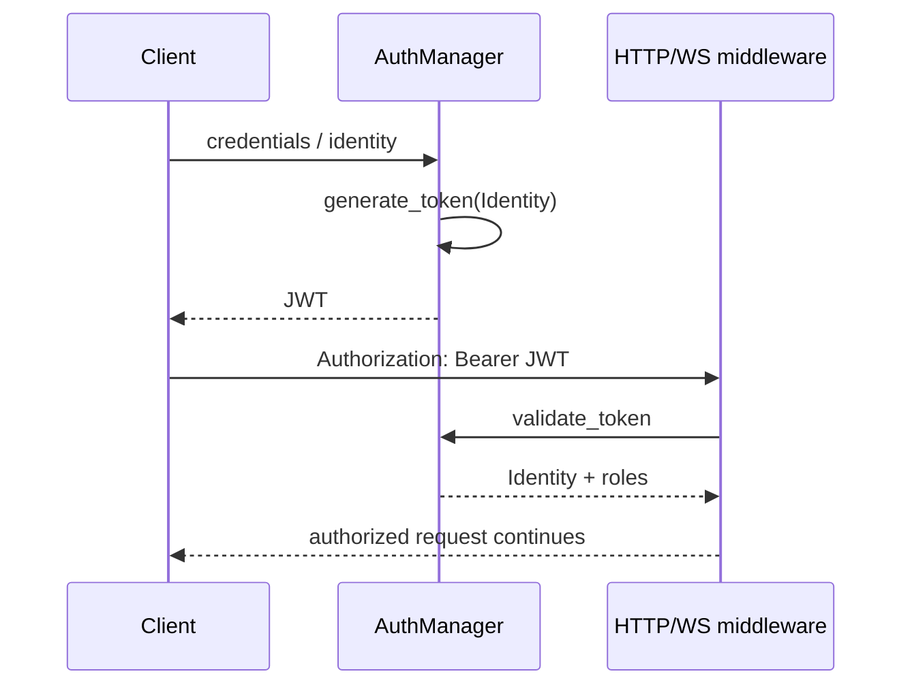
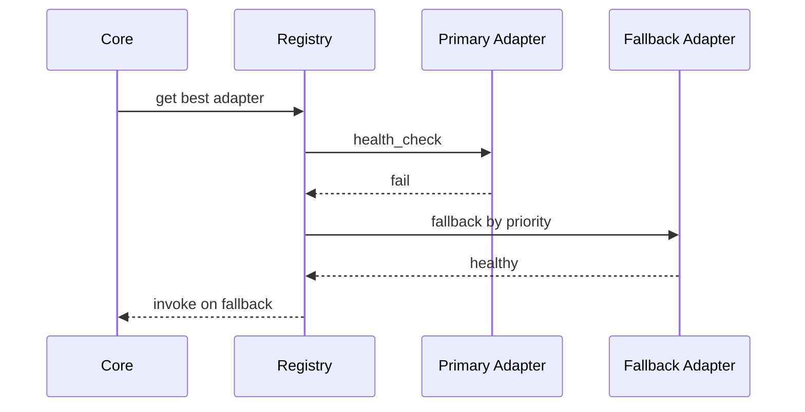

# Sequence Diagrams

## CLI query → adapter

## WebSocket streaming

## Authentication (JWT)

## Error path (adapter unavailable)

Message types are defined in `crates/mimi-cli/src/ws/types.rs` and auth in `crates/mimi-cli/src/auth/`.
